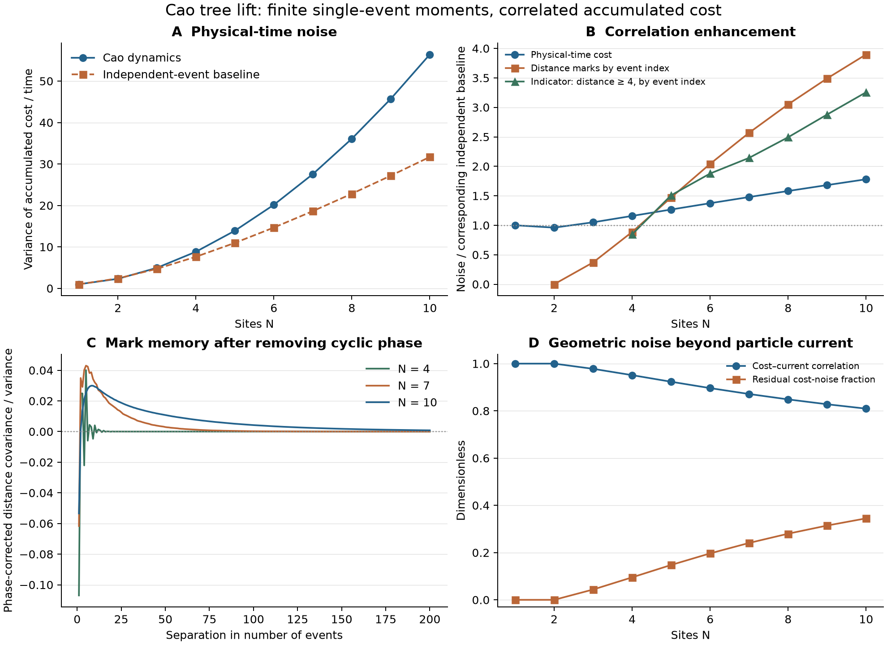

# Temporal correlations of geometric transport cost

2026-11-11. Continues the [exact distance law](tasep_rotation_distances.md).
Code: [tasep_rotation_noise.py](tasep_rotation_noise.py).
Raw output: [tasep_rotation_noise_results.json](tasep_rotation_noise_results.json).
Independent derivation and primary sources: [theory audit](tasep_rotation_noise_theory.md).

## Main finding

A bounded single-event mean and variance do not make successive costs independent.
In the unit-rate Cao lift, exact finite-generator calculations through
N=10 show increasing positive integrated correlations at the larger
computed sizes. At N=10:

* Physical-time accumulated-cost variance is **1.78021 times** the
  independent compound-Poisson baseline.
* The centered sum of distances by event number has **3.89758 times** the
  variance of independent marks with the same one-event distribution.
* The centered count of marks with distance >=4 has **3.25619 times** its
  independent Bernoulli baseline, demonstrating clustering of larger
  events in the event-index sequence, separately from waiting-time effects.
* Cost and particle-current fluctuations have correlation coefficient
  **0.809374**. An optimal linear subtraction of particle current leaves
  **34.49%** of the cost variance rate.

There is also an all-size theorem: for every N>=3, ordinary particle
current cannot account for all the geometric noise. That theorem is
distinct from the numerical enhancement ratios and supplies no large-N
exponent for them.



Vector figure: [SVG](tasep_rotation_noise.svg).

## Observables and units

Keep the original continuous-time process: every marked cherry fires at
rate one. No new clock is assigned to the rotations measuring an event's
distance. Define

\[
A_t=\sum_{\text{jumps}\le t}d_e,\qquad
K_t=\#\{\text{jumps}\le t\},\qquad
Q_t=\#\{\text{injections}\le t\}.
\]

The covariance convention throughout is

\[
V_{ab}=\lim_{t\to\infty}\frac{\operatorname{Cov}(A_t^{(a)},A_t^{(b)})}{t}.
\]

There is **no factor of two** in this definition. Some literature calls
V/2 the diffusion coefficient.

The known stationary tree measure is uniform. If Lambda is the stationary
jump rate and m the event-average distance,

\[
J_N=\frac{N+2}{4N+2},\quad
\Lambda_N=(N+1)J_N,\quad
\mu_A=\Lambda_Nm=N-1+\frac3{2N+1}.
\]

These are all-size identities from the exact stationary weights and
distance mean. For N=10, Lambda=22/7, m=32/11, and mu_A=64/7.

## Finite-generator results

The numbers below are obtained by solving the finite generator's Poisson
equations, not by estimating a variance from a finite simulated trajectory.
N<=3 also has exact rational arithmetic checks. Larger systems use sparse
double-precision linear algebra with independent validations below.

| N | Trees | V_AA | Independent-event shot baseline | V_AA / shot | Mark-noise / iid mark-noise | Cost/current correlation |
|---|---:|---:|---:|---:|---:|---:|
| 2 | 5 | 2.304000 | 2.400000 | 0.960000 | 0 | 1 |
| 3 | 14 | 4.953353 | 4.714286 | 1.050711 | 0.370732 | 0.977873 |
| 4 | 42 | 8.827963 | 7.619048 | 1.158670 | 0.887275 | 0.951179 |
| 5 | 132 | 13.902577 | 10.969697 | 1.267362 | 1.470660 | 0.923249 |
| 6 | 429 | 20.155338 | 14.666667 | 1.374228 | 2.041777 | 0.896297 |
| 7 | 1430 | 27.560558 | 18.636364 | 1.478859 | 2.569581 | 0.871302 |
| 8 | 4862 | 36.090648 | 22.823529 | 1.581291 | 3.050513 | 0.848542 |
| 9 | 16796 | 45.718508 | 27.186235 | 1.681679 | 3.490597 | 0.827961 |
| 10 | 58786 | 56.418931 | 31.692308 | 1.780209 | 3.897580 | 0.809374 |

The independent physical-time baseline is a Poisson clock of rate Lambda
with iid event distances drawn from the **same** stationary mark law:

\[
S_A=\Lambda\,\mathbb E_{\rm event}[d^2].
\]

At N=10, the one-event variance is only 1.621106, whereas the asymptotic
variance per event of the centered mark sum is 6.318391. The ratio is
3.897580. This latter quantity is not the previously proved limiting
single-event variance 6; its own large-size limit is unknown.

Enhancement is not automatic at tiny sizes. At N=2 the mark sequence is
periodic with zero centered-sum variance, and physical-time noise is
slightly suppressed. At N=3,4 the centered mark sum is still less noisy
than iid marks, although the combined physical-time cost noise exceeds
its compound-Poisson baseline. Clock fluctuations, mark fluctuations,
and their covariance must be kept separate.

## Poisson equations, martingales, and validation

Use row generator L acting on column functions. For an edge observable g,
let `b_g(x)=sum_{e:x->y} q_e*g_e` and `mu_g=pi*b_g`. Solve

\[
Lh_g=\mu_g1-b_g,\qquad \pi h_g=0.
\]

Then `sum g - mu_g*t + h_g(X_t)-h_g(X_0)` is a martingale, and

\[
\boxed{V_{gk}=\sum_{e:x\to y}\pi_xq_e
  (g_e+h_g(y)-h_g(x))(k_e+h_k(y)-h_k(x)).}
\]

Here g,k are edge observables and h_g,h_k are their state correctors.
An equivalent formula is

\[
V_{gk}=\pi\sum q_e g_ek_e+\pi B_gh_k+\pi B_kh_g,
\qquad (B_gf)(x)=\sum q_e g_ef(y).
\]

For cost alone, write `K_A(s)=pi*B_d*exp(sL)*(b_d-mu_A)`, s>0. Then

\[
V_{AA}=S_A+2\int_0^\infty K_A(s)\,ds.
\]

This is the covariance density of the **jump flux** after the delta spike
has been separated. It is generally not the autocovariance of the local
rate b_d(X_t). The script stores both curves with distinct names.

For an independent eigenvalue check, tilt off-diagonal event rates by
`exp(theta*g_e)` and keep the original escape diagonal. The first and
second derivatives of the principal eigenvalue give mean and variance
rates. This construction is documented in
[Chetrite–Touchette, equations 46–47 and 56](https://arxiv.org/pdf/1405.5157).

Checks completed:

1. Uniform stationarity, strong connectivity, and row conservation at every
   size through N=10.
2. Agreement between squared corrected increments and the bilinear
   Poisson formula for the complete 3-by-3 covariance matrix.
3. Exact fraction calculations through N=3. For example,
   `V_AA(2)=288/125`, `V_AA(3)=1699/343`.
4. Tilted-generator first and second derivatives through N=5 using two
   finite-difference step sizes; all agree with Poisson values.
5. A separately constructed TASEP generator reproduces the tree lift's
   event-count/current covariance at every computed size.
6. Current variance agrees through N=10 with the known factorial formula
   in [Antal–Krapivsky–Mallick, equation 32](https://arxiv.org/pdf/0705.2594),
   resolving its convention `D=Var/(2t)` and mapping their leg count to
   N+1. The exact formula and source mapping are in the theory audit.
7. Particle conservation gives `V_KK=(N+1)^2*V_QQ` and
   `V_AK=(N+1)*V_AQ`; both hold numerically.

The largest Poisson-equation residual is about 2.1e-11. Uniform means are
calculated by summing integer event rewards before division, and grounded
sparse solves use residual refinement. This avoids a small stationarity
defect from long floating-point dot products at N=10.

## Event-index memory and the cyclic phase

Let D_j denote the j-th event distance and define

\[
v_N=\lim_{M\to\infty}\frac1M
\operatorname{Var}\left(\sum_{j=1}^M(D_j-m)\right).
\]

Its independent-mark baseline is the single-event variance. It can be
obtained from the physical-time covariance matrix without another solve:

\[
\boxed{v_N=\frac{V_{AA}-2mV_{AK}+m^2V_{KK}}{\Lambda_N}.}
\]

The script also checks it directly using the embedded-chain Poisson
equation. Centering by m is crucial: this is the residual `A_t-mK_t`,
not the uncentered total cost evaluated at a random number of events.

There is an exact periodicity. The phase

\[
\Phi(\eta)=\sum_{i=1}^N i\eta_i\pmod{N+1}
\]

advances by one on every injection, hop, or extraction. All cycle lengths
are multiples of N+1. A right-comb cycle of length N+1 proves that the
embedded chain has period exactly N+1. Its irreducibility follows because
every canopy can be emptied and the all-empty fiber contains one tree;
the positive uniform stationary measure excludes transient states.

Let m_phi be the conditional event distance mean at a given source phase.
The phase classes have equal event-stationary masses. Subtracting m_phi
rather than m removes a cyclic state-potential difference, so it changes
no asymptotic variance. This yields decaying residual mark correlations
instead of retaining deterministic phase oscillations.

The script calculates the phase part exactly and subtracts it from each
lag covariance. The finite sum through 800 lags agrees with the Poisson
answer to about 1.8e-5 at N=10, better at smaller sizes. Reported variance
rates come from the Poisson solve, not that truncated sum.

For N=2 all marks are the repeating pattern 1,2,1 up to phase shift.
Single-event variance is 2/9, but centered partial sums stay bounded and
v_2=0. This supplies a useful negative control against mistaking phase
oscillations for stochastic memory.

At N=10 the phase-corrected distance covariance is negative at lag one,
then develops a positive tail. Its normalized integrated correlation time
is about 1.949 event steps (defined as `v_N/(2*residual_mark_variance)`).
The local physical-time cost-rate observable has integrated correlation
time about 1.972 in the original clock units. Neither number is a spectral
mixing time or an established asymptotic scaling law.

## A theorem: noise not reducible to ordinary particle current

For every event, subtract its minimal canopy cost: 2 for bulk hops, 1 for
boundaries. Define the nonnegative remainder r_e. Conservation gives

\[
A_t=2NQ_t+R_t-\Delta W,\quad
R_t=\sum r_e,\quad
W(\eta)=\sum_{j=1}^N[2(N-j)+1]\eta_j.
\]

Its exact stationary mean rate is

\[
\mu_R=\frac{(N-1)(N-2)}{2N+1}.
\]

A right-comb cycle has one injection and costs `(1,2,...,2,1)`, total 2N.
Thus an identity `d_e=c*injection_e+potential difference` would force c=2N.
For N>=3, positive mu_R and irreducibility imply a cycle with positive
total remainder, contradicting that coefficient. The same proof rules
out any fixed linear combination of bond counters plus a state potential.

Zero variance of a CTMC jump observable forces every corrected martingale
increment to vanish, hence the observable must telescope as a potential.
Therefore, for every N>=3,

\[
\boxed{V_{AA}-\frac{V_{AQ}^2}{V_{QQ}}>0.}
\]

This is an all-size statement of residual geometric noise after optimal
linear subtraction of ordinary particle current. At N=10 the residual is
19.459681, or 34.49% of V_AA. It is uncorrelated with the subtracted current
in the long-time covariance sense; statistical independence is not implied.

The centered mark variance v_N is likewise strictly positive for every
N>=3: zero would force all cycle-average distances to equal m, but the
right-comb mean `2N/(N+1)` differs from m by
`2(N-1)(N-2)/((N+1)(N+2))`. This does not say v_N exceeds the iid baseline
at every size; indeed it does not for N=3,4.

## What remains open

We have no closed all-size formula or growth exponent for V_AA, v_N,
their enhancement ratios, or their correlation times. The finite-size
increase through ten sites is real in the solved generators, but does
not establish a divergent large-system limit. The previously proved
geometric tail and finite mean/variance concern one event and impose
no independence between successive events.

The next mathematical target is a structural solution of the cost Poisson
equation or a large-size theory for the nonnegative excess R_t. That would
determine which part of the observed growth survives asymptotically.

## Reproduce

```sh
uv run --python 3.12 --with numpy --with scipy python math_project/experiments/tasep/tasep_rotation_noise.py --max-sites 10 --lags 800
uv run --python 3.12 --with numpy --with matplotlib python math_project/experiments/tasep/tasep_rotation_noise_plot.py
```

The first command took about 35 seconds on the machine used here; it
rewrites the noise JSON. The second creates PNG and SVG figures from that
JSON. The original distance and thermodynamics results are preserved.
