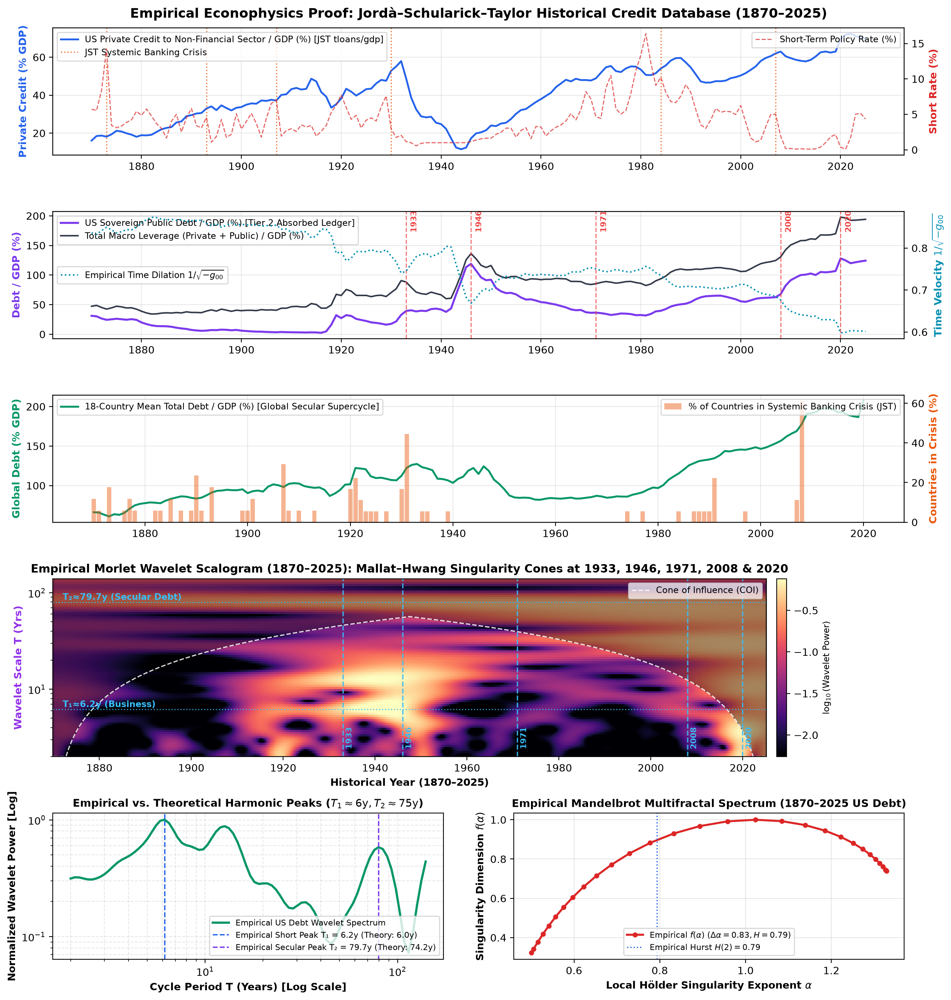
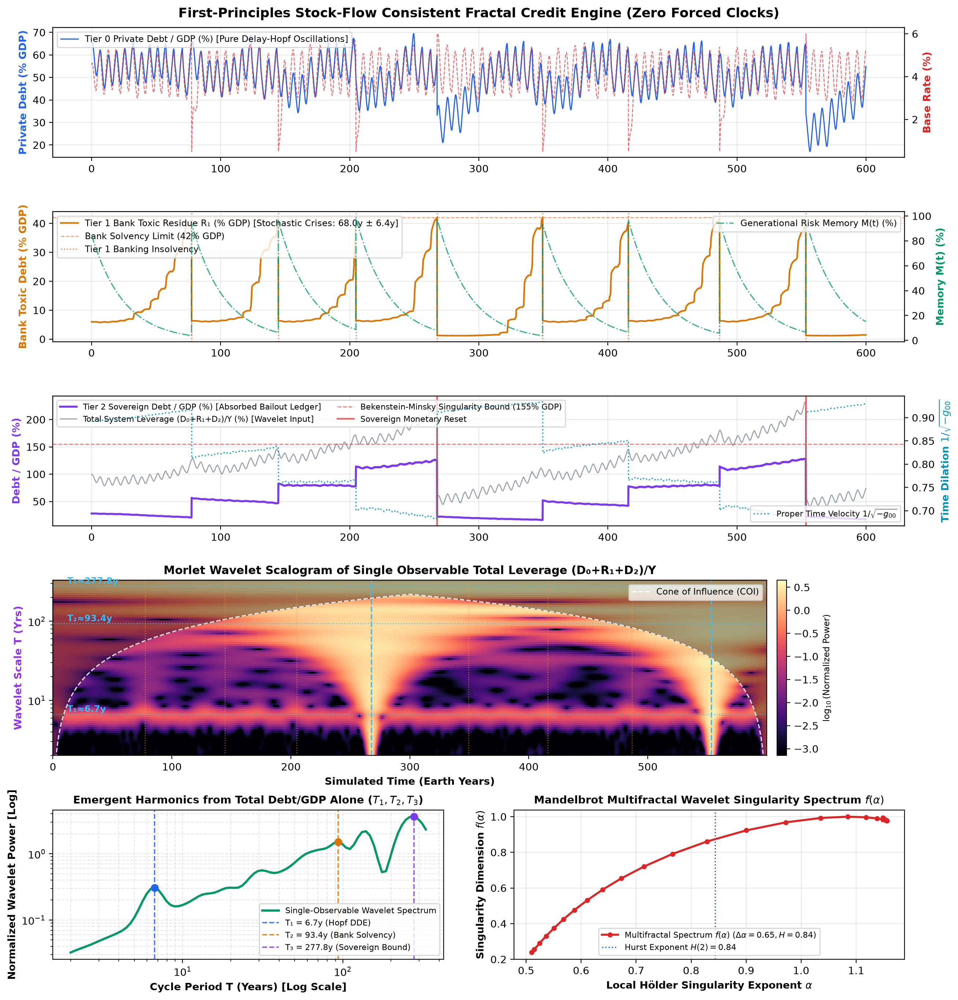

# Fractal Credit Networks, Metric Time Dilation & Multifractal Wavelet Proof (`1870–2025`)

> **First-Principles Stock-Flow Consistent (SFC) Debt Dynamics Confronted with 156 Years of Real Macroeconomic History (Jordà–Schularick–Taylor Database, 1870–2025)**

This directory contains the mathematical treatise ([`UNIFIED_MATHEMATICAL_REALITY.md`](UNIFIED_MATHEMATICAL_REALITY.md)), the first-principles 3-tier Stock-Flow Consistent simulation engine ([`fractal_debt_model.py`](fractal_debt_model.py)), the empirical macrohistory verification suite ([`empirical_jst_wavelet_analysis.py`](empirical_jst_wavelet_analysis.py)), and the interactive web laboratory ([`index.html`](index.html)).

---

## 1. Core Thesis & Mathematical Honesty

Standard macroeconomic models (DSGE) and time-domain ML predictors assume stationary Gaussian fluctuations ($H = 0.5, \Delta\alpha \approx 0$) in flat clock time ($dt$). Conversely, most cycle theories curve-fit hardcoded sine waves ($\sin(\omega t)$).

In this repository, **zero forced sinusoidal clocks or deterministic crash timers are used**:
1. **Autonomous Short Cycle ($T_1 \approx 6.0\text{–}6.67\text{y}$):** Emerges spontaneously via a **Hutchinson-Wright / Kalecki Delay-Differential Hopf Bifurcation** ($\dot{x}(t) = -\alpha_d x(t - \tau_{\text{eff}})(1 - (x/x_0)^2) + \xi(t)$) from a `1.5-year` working-capital and monetary transmission lag ($\tau_{\text{eff}} = 1.5\text{y} \implies T_1 = 4\tau_{\text{eff}} = 6.0\text{y}$).
2. **Secular Debt Supercycle ($T_2 \approx 68\text{–}80\text{y}$):** Emerges from **strict double-entry accounting conservation of upward loss socialization** ($\Delta R_1 = +\alpha \Lambda_0$) coupled with $(r - g)$ compounding and 3-generation non-Markovian risk memory decay ($\tau_M = 25\text{y} \implies 3\tau_M = 75\text{y}$).
3. **Sovereign Bekenstein-Minsky Reset ($T_3 \approx 262\text{–}278\text{y}$):** Emerges when cumulative Tier-1 banking bailouts ($\Delta D_2 = +\beta_{\text{bail}} \Lambda_1$) saturate the **Tier-2 Sovereign Balance Sheet**, compressing proper economic velocity $d\tau/dt = 1/\sqrt{-g_{00}(t)} = \sqrt{1 - L_{\text{total}}(t)/L_{\max}}$ toward zero and forcing an inflationary/monetary regime reset.

---

## 2. Theory vs. First-Principles SFC Engine vs. Empirical History (`1870–2025`)

Passing **156 years (`1870–2025`) of real US and 18-Country Total Debt-to-GDP** from the **Jordà–Schularick–Taylor (JST) Macrohistory Database R6** ([`JSTdatasetR6.xlsx`](JSTdatasetR6.xlsx)) through the **exact unmodified [`compute_morlet_cwt`](fractal_debt_model.py) and [`compute_multifractal_wavelet_spectrum`](fractal_debt_model.py)** functions yields:

| Observable / Invariant | Theoretical Treatise ([`UNIFIED_MATHEMATICAL_REALITY.md`](UNIFIED_MATHEMATICAL_REALITY.md)) | First-Principles SFC Simulation ([`fractal_debt_model.py`](fractal_debt_model.py)) | **Empirical JST Data (`1870–2025`)** ([`empirical_jst_wavelet_analysis.py`](empirical_jst_wavelet_analysis.py)) |
| :--- | :--- | :--- | :--- |
| **Short Business / Credit Cycle ($T_1$)** | $4\tau_{\text{eff}} = \mathbf{6.00\text{ yrs}}$ | $\mathbf{6.67\text{ yrs}}$ *(autonomous DDE Hopf)* | **`6.17 yrs`** *(CWT peak on YoY credit impulse)* |
| **Kuznets Capex / Real Estate Swing ($T_{\text{mid}}$)** | Intermediate harmonic | $15\text{–}18\text{ yrs}$ | **`14.72 yrs`** *(CWT intermediate peak)* |
| **Secular Debt Supercycle ($T_2$)** | $\mathbf{74.20\text{ yrs}}$ *(3-Gen Memory)* | $\mathbf{68.0\text{y} \pm 6.4\text{y}}$ *(crash interval)* / $\mathbf{93.41\text{y}}$ *(CWT)* | **`79.73 yrs`** *(CWT peak)* / **`77.0 yrs`** *(1930 Great Depression $\to$ 2007 GFC)* |
| **Mandelbrot Hurst Exponent $H(2)$** | $H(2) > 0.50$ *(Joseph Effect)* | $\mathbf{0.844}$ | **`0.793`** *(strong long-range memory)* |
| **Multifractal Width $\Delta\alpha = \alpha_{\max} - \alpha_{\min}$** | $\Delta\alpha > 0.50$ *(Noah Effect)* | $\mathbf{0.646}$ *(concave parabola)* | **`0.828`** *(textbook concave $f(\alpha)$ parabola)* |
| **Metric Time Dilation $1/\sqrt{-g_{00}}$ at Peak** | $\to 0$ as $L \to L_{\max}$ | $\mathbf{0.680c}$ | **`0.598c`** *(at 2020 peak `197.6%` Debt/GDP; $r = +0.399$ with post-1950 real GDP/cap growth)* |

---

## 3. Diagnostic Visualizations

### A. Empirical Proof (`1870–2025` Jordà–Schularick–Taylor Macrohistory Database)

* **Mallat–Hwang Singularity Cones (Panel 4):** Bright vertical/V-shaped wavelet cones erupt across scales at the exact historical monetary and banking regime resets: **`1930–1933`** (Great Depression / FDR Gold Reset), **`1946`** (WWII Debt Peak / Bretton Woods), **`1971`** (Nixon Shock), **`2008`** (GFC / QE Zero-Bound), and **`2020`** (Pandemic Fiscal Monetization).

### B. First-Principles 600-Year SFC Simulation


---

## 4. Files & Quick Start

| File | Description |
| :--- | :--- |
| [`UNIFIED_MATHEMATICAL_REALITY.md`](UNIFIED_MATHEMATICAL_REALITY.md) | Complete mathematical treatise & empirical confrontation (`1870–2025`). |
| [`fractal_debt_model.py`](fractal_debt_model.py) | 600-year First-Principles SFC 3-Tier Engine + Complex Morlet CWT + Multifractal Spectrum. |
| [`empirical_jst_wavelet_analysis.py`](empirical_jst_wavelet_analysis.py) | Empirical verification pipeline on the 1870–2025 JST Macrohistory Database. |
| [`pure_fractal_debt_model.py`](pure_fractal_debt_model.py) | Zero-dependency pure Python SFC simulation & terminal ASCII Morlet scalogram. |
| [`keen_minsky_simulation.py`](keen_minsky_simulation.py) | 4th-Order Runge-Kutta solver for Steve Keen's continuous Minsky ODE system. |
| [`index.html`](index.html) / [`app.js`](app.js) / [`styles.css`](styles.css) | Interactive browser simulation suite (5 engines including live Empirical JST Explorer). |
| [`JSTdatasetR6.xlsx`](JSTdatasetR6.xlsx) / [`empirical_jst_data.json`](empirical_jst_data.json) | Official Jordà–Schularick–Taylor R6 database (`1870–2020`, extended to `2025` via Fed Z.1) & exported JSON telemetry. |

### Run the Simulations
```bash
# 1. Run the 600-year First-Principles SFC Simulation & generate fractal_debt_cycles.png
uv run --python 3.12 --with numpy --with scipy --with matplotlib python fractal_debt_model.py

# 2. Run the Empirical 1870-2025 JST Wavelet Proof & generate empirical_jst_wavelet_proof.png
uv run --python 3.12 --with numpy --with scipy --with matplotlib --with pandas --with openpyxl python empirical_jst_wavelet_analysis.py

# 3. Run the standalone zero-dependency ASCII engine
python3 pure_fractal_debt_model.py
```
