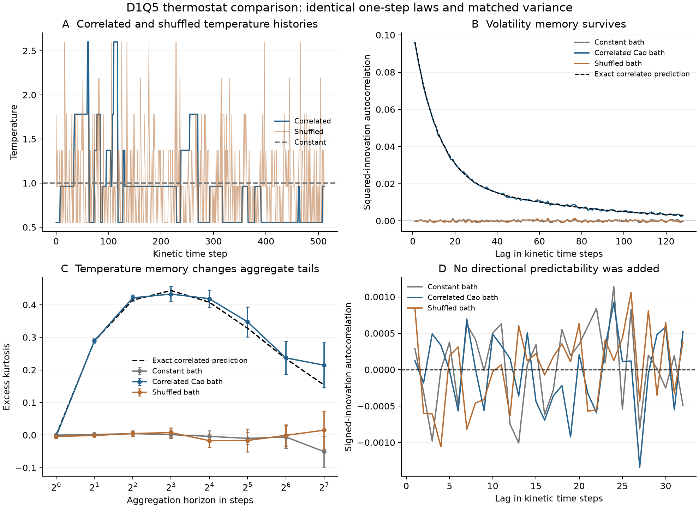

# A correlated thermostat for the kinetic engine

2026-11-11. Implementation: [kinetic_cao_thermostat.py](kinetic_cao_thermostat.py).
Results: [JSON](kinetic_cao_thermostat_results.json).
Independent mathematical checks: [theory audit](kinetic_cao_thermostat_theory.md).
Core engine: [kinetic_options_v2.py](kinetic_options_v2.py).

## Result

The activity-driven thermostat produces squared-return memory and positive
finite-horizon excess kurtosis while preserving the unconditional return
variance. Constant-temperature and shuffled-temperature controls lose
almost all of that effect. This is a controlled kinetic mechanism, using
the same D1Q5 collision kernel in all three cases.

The three cases have exactly the same one-step velocity law in the
stationary ensemble. Therefore a one-step distribution, mean variance,
or temperature histogram alone cannot explain the difference in their
aggregated return statistics. The order of the temperatures matters.

This tests **centered kinetic innovations**, explicitly at zero lattice
drift. It is not an option-pricing calibration or a risk-neutral stock-price
simulation. The reference volatility 14% and the day-sized step are units
chosen for the experiment, not estimates from market data.



[Vector figure](kinetic_cao_thermostat.svg). Kurtosis error bars are twice
the standard error across 16 independent stationary thermostat batches.

## Experiment and constitutive assumptions

The reservoir is the already-audited unit-rate Cao tree process with
five TASEP sites, hence 132 tree states. For each outgoing event subtract
the minimum canopy cost: 2 for a bulk hop and 1 for a boundary event.
The state activity is the total outgoing **geometric excess**:

\[
a(T)=\sum_{e:T\to T'}(d_e-d_{\min,e})\ge0.
\]

This is not just the number of cherries or active particle bonds. It
uses the tree geometry. Its stationary mean is 12/11 and its range is 0..5.
The chosen coupling is

\[
\boxed{\theta(T)=1+\frac{88}{215}\left(a(T)-\frac{12}{11}\right).}
\]

It has mean one and range `[119/215,13/5]`, approximately `[0.553488,2.6]`.
The temperature variance is 0.2067568055. The affine activity-to-temperature
map is a **new constitutive assumption**, not implied by the tree theorems.
The gain was selected to keep the bath within a declared safe range, not
fitted to return correlations or kurtosis.

The reservoir generator is `0.05*L` per kinetic step. Its time scale is
also a chosen model parameter. Gillespie trajectories are sampled at
integer physical times, retaining repeated samples during holding times.
Every batch begins from a uniform tree, giving exact stationarity without
burn-in. Sampling just at jump times would produce the wrong reservoir
measure and is not used here.

Compare:

1. **Constant:** theta=1.
2. **Correlated:** the stationary temperature path above.
3. **Shuffled:** a uniform permutation of the same batch's temperature path.

There are 16 independent batches of 262144 steps, or **4,194,304 innovations
per case**. Independent random streams drive the reservoir, permutations,
and velocities. The same fresh velocity uniforms are used across cases
to reduce noise in paired comparisons; each case still has its prescribed
law. No temperature normalization per realized path, return rescaling,
population clipping, or mass renormalization is used.

## Collision rule, positivity, and variance matching

Use full relaxation `tau=1`, so velocities reset at each collision.
The common v2 zero-drift equilibrium is

\[
p_\theta(0)=\frac{3-\theta}{4},\qquad
p_\theta(\pm1)=\frac16,\qquad
p_\theta(\pm2)=\frac{3\theta-1}{24}.
\]

It is nonnegative for `1/3<=theta<=3`. Our entire temperature range is
strictly inside that interval. The implementation checks every equilibrium
population and raises an error for an unrealizable input.

Its exact moments are

\[
E[c\mid\theta]=0,\quad E[c^2\mid\theta]=\theta,\quad
E[c^4\mid\theta]=4\theta-1.
\]

The fourth moment is **not** `3*theta^2` for arbitrary theta. This is a
finite-velocity Hermite equilibrium, not a full Gaussian temperature
family. At stationary mean temperature one, linearity gives

\[
P(c)=W_c,\qquad E[c^2]=1,\quad E[c^4]=3,
\quad\operatorname{Var}(c^2)=2.
\]

Thus all three cases have the same complete one-step law and zero
one-step excess kurtosis. Zero kurtosis does not make this five-atom law
Gaussian. With `dx=sigma*sqrt(dt)`, centered innovations are `dx*c`, and

\[
\boxed{\operatorname{Var}(R_H)=H\sigma^2dt}
\]

at **every** horizon, in all three cases. Conditional centering and fresh
velocity draws give zero signed-return covariance at nonzero lags, even
with temperature memory. Setting tau=1 isolates the thermostat effect
from the velocity persistence that v2 explores at larger tau.

The raw Monte Carlo one-step variances in lattice units are:

| Bath | Estimated variance | Batch standard error | Exact variance |
|---|---:|---:|---:|
| Constant | 1.000573 | 0.000883 | 1 |
| Correlated | 1.002631 | 0.001476 | 1 |
| Shuffled | 1.002617 | 0.001589 | 1 |

The finite-sample differences are reported rather than removed. The
target dimensional one-step variance is `0.14^2/252 = 7.77778e-5`.

## Exact predictions and simulation

Let `C_theta(l)=Cov(theta_t,theta_{t+l})` in the stationary physical-time
sampled reservoir. Its transition matrix is `P=exp(0.05*L)`, giving

\[
C_\theta(l)=\frac1{132}(\theta-1)^\top P^l(\theta-1).
\]

The exact squared-innovation correlation, for l>0, is

\[
\boxed{\rho_{c^2}(l)=\frac{C_\theta(l)}2.}
\]

At lag one the prediction is **0.0962711**. Estimates are

| Bath | Squared-return correlation, lag 1 | Batch standard error |
|---|---:|---:|
| Constant | -0.000110 | 0.000459 |
| Correlated | 0.095876 | 0.000432 |
| Shuffled | -0.000123 | 0.000270 |

For an H-step sum, conditional independence and symmetry give

\[
\boxed{\kappa_H=\frac6{H^2}\sum_{l=1}^{H-1}(H-l)C_\theta(l).}
\]

This is exact for the stationary ensemble, including averaging over the
reservoir history. Propagating the joint tree/return moments independently
reproduces this formula. It avoids estimating a small fourth cumulant
solely from noisy return paths.

| Horizon H | Exact correlated excess kurtosis | Simulated correlated value | Batch standard error |
|---|---:|---:|---:|
| 1 | 0 | -0.003915 | 0.003124 |
| 2 | 0.288813 | 0.289287 | 0.003117 |
| 4 | 0.414079 | 0.421111 | 0.004504 |
| 8 | 0.443556 | 0.432731 | 0.011397 |
| 16 | 0.407703 | 0.418519 | 0.013312 |
| 32 | 0.327895 | 0.347456 | 0.022863 |
| 64 | 0.234467 | 0.236895 | 0.025002 |
| 128 | 0.153623 | 0.214550 | 0.034511 |

Constant and ideal iid-temperature controls have exact excess kurtosis
zero at every horizon. The actual finite permutation retains a tiny
common random record-mean effect: its exact ensemble kurtosis is about
0.000095 at H=8 and 0.000108 at H=128. This is far below the Monte Carlo
uncertainty. Conditional fixed-record negative permutation covariance
and unconditional random-record covariance are distinguished in the
theory audit and in `shuffled_predictions`.
The empirical ACF centers each batch, removing part of its small random
record-mean contribution; this finite-sample effect is much smaller than
the displayed correlation standard errors.

The paired correlated-minus-shuffled H=16 estimate is **0.435535 +/-
0.018894** (one batch standard error). The exact difference is approximately
0.407601. At long horizons fourth-moment estimates are visibly noisier;
the exact curve, rather than individual Monte Carlo deviations, supplies
the mathematical prediction.

Temperature's integrated correlation time in this chosen clock is about
23.46 kinetic steps. Summable finite-state covariance implies eventual
`kappa_H ~ 6*sum_{l>=1}C_theta(l)/H`, whose coefficient is about 28.49 here.
The thermostat produces finite-horizon excess kurtosis, not permanently
non-Gaussian aggregation or a power-law tail. At finite H the innovation
sum has bounded support `[-2H*dx,2H*dx]`.

## Engine changes and verification

`kinetic_options_v2.py` now exposes `equilibrium_populations(theta,u)` so
the density solver and tracer experiment use the same checked collision
law. Its `evolve` method also accepts `temperature_schedule`, an array of
N absolute global temperatures. This is separate from its existing static
spatial multiplier m(x). Supplying both is rejected.

One scheduled-density call conditions on one reservoir history. An
unconditional option distribution would require averaging over histories
or propagating the joint reservoir/position law. The innovation experiment
uses independent stationary histories and stationary windows instead.

Verification performed:

* Exact equilibrium mass, symmetry, second and fourth moments, and rejection
  of temperatures outside the realizability interval.
* A time-dependent scheduled density agrees with independent convolution
  of its step distributions to **1.39e-17**; mass is **0.9999999999999989**.
* A flat schedule reproduces the original static-temperature call.
* The existing flat-temperature Black–Scholes check remains within
  **Rs 0.074** on the three tested strikes (tau=1, 600 steps).
* Independent joint-moment propagation agrees with the temperature-covariance
  kurtosis formula. Frozen-temperature and iid-temperature limits agree
  with their exact formulas.
* The independent audit also enumerated a two-state bath with exact rational
  arithmetic, validating the short-horizon formulas without the Cao code.
* The Gillespie/particle simulation agrees with the semigroup predictions
  at the scale of its independently estimated batch errors.

## What this adds to the kinetic model

The comparison supplies an explicit finite microscopic bath whose memory
passes into conditional return variance. The shuffled control shows that
temperature variability alone does not account for the aggregate-kurtosis
effect in this particular D1Q5 kernel. No continuum PDE or externally
specified memory kernel is required for the bath calculation.

It remains an **exogenous thermostat**. Price moves do not heat or cool the
trees, there is no energy-balance equation, and no downside feedback or
leverage effect has been added. Conditional symmetry makes return skewness
zero in this innovation experiment. The activity-to-temperature map and
clock speed have not been calibrated against market observations.

The next implementation target, if extending this prototype, is a genuine
price/temperature coupling with a controlled energy budget, followed by
a martingale check before any option-price comparison. Using `r=0` in the
pricing solver alone would not reproduce this zero-drift experiment: its
usual log-price drift still contains `-sigma^2*theta/2`.

## Reproduce

```sh
uv run --python 3.12 --with numpy --with scipy --with matplotlib python useless_research/Economics/kinetic_cao_thermostat.py
```

The default run uses the fixed seed 20261111 and creates the JSON, PNG, and
SVG beside the script. It took about five seconds for the computation on
this machine, plus figure rendering. Existing v2 experiment artifacts are
preserved.
